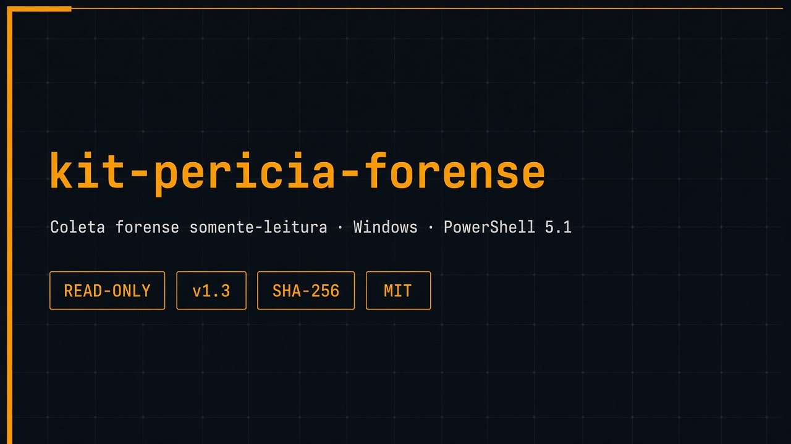
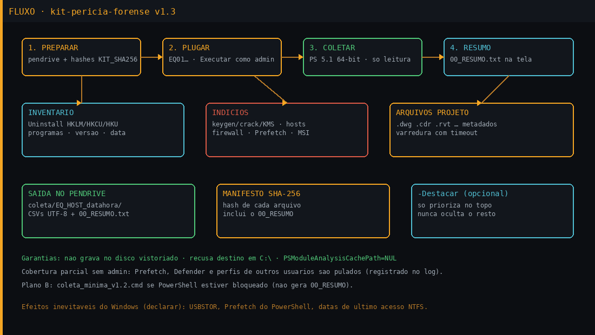
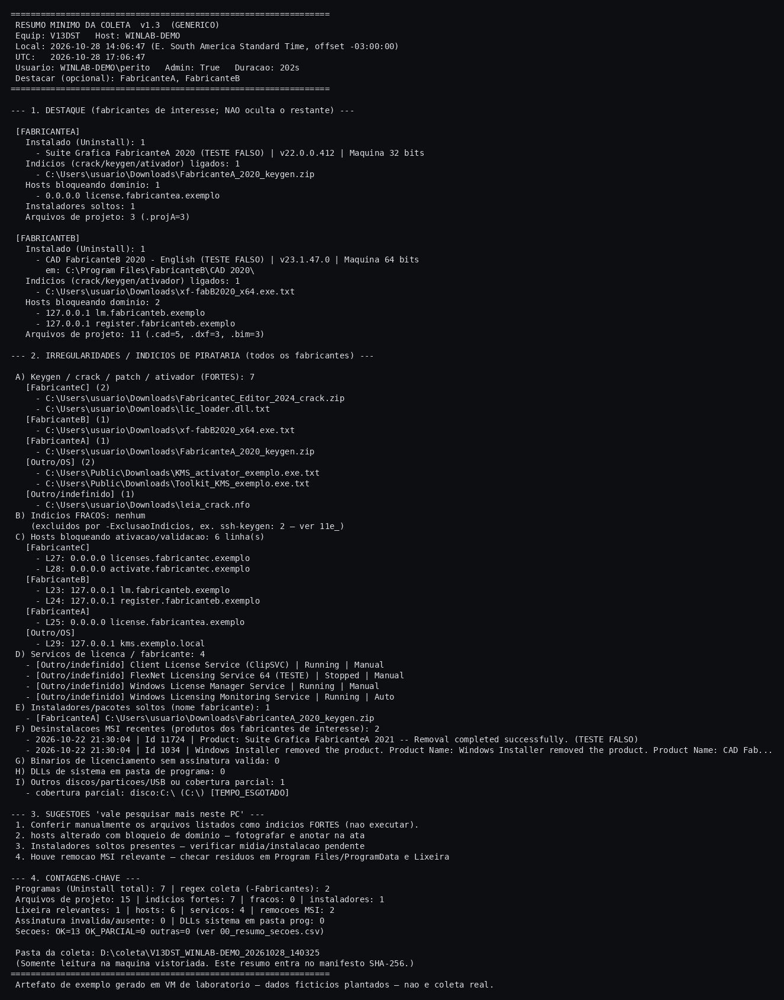

<p align="center">
  
</p>

# kit-pericia-forense

**Coleta forense somente-leitura** de inventário de software em Windows. Feito para vistoria em campo: roda do pendrive, não grava no disco vistoriado, imprime um resumo na tela e fecha com manifesto SHA-256.

> PowerShell 5.1 nativo · ASCII+UTF-8 BOM · saída só no pendrive · `00_RESUMO.txt` genérico · `-Perfil` · hives offline · fallback Defender

[](#)
[](#garantias-somente-leitura)
[](LICENSE)

---

## O que é

Script de perícia / vistoria de software que monta, em minutos, um pacote de evidências **somente por leitura**:

- programas instalados (registro Uninstall 64/32 bits + HKCU/HKU);
- indícios por nome (keygen, crack, KMS, patch, ativador…);
- hosts e firewall que bloqueiam ativação;
- metadados de arquivos de projeto (extensões configuráveis);
- Prefetch, eventos MSI, Lixeira, Defender (quando há admin);
- **`00_RESUMO.txt`** — veredito curto em português, impresso na tela e coberto pelo manifesto.

Não substitui imagem forense (FTK/E01). É o kit leve de **campo**, para ler na frente da máquina e anexar ao laudo.

<p align="center">
  
</p>

---

## Garantias (somente leitura)

| Promessa | Como |
|---|---|
| Nada é gravado no disco vistoriado | Saída só no pendrive; destino em `C:\` é **recusado** (código 2) |
| Política de execução intacta | `-ExecutionPolicy Bypass -File` só naquela sessão |
| Sem cache de módulo no perfil | `PSModuleAnalysisCachePath=NUL` |
| Sem `Win32_Product` | Inventário via registro .NET (read-only) — não dispara repair MSI |
| Hive deslogado (v1.4+) | Opt-in `-LerHivesOffline` (desligado desde v1.4.2): cópia no pendrive + `reg load` só da cópia |
| Sem compilar C# | Nada em `%TEMP%` via `Add-Type` |
| Resumo no manifesto | `00_RESUMO.txt` é escrito **antes** do SHA-256 |

**Efeitos inevitáveis do Windows** (declarar no laudo): USBSTOR / MountedDevices ao plugar o pendrive; Prefetch e eventos do PowerShell; possível atualização de *last-access* NTFS nas pastas listadas.

---

## O que coleta (visão rápida)

| Grupo | Arquivos típicos |
|---|---|
| Resumo e log | `00_RESUMO.txt`, `00_log_execucao.txt`, `00_resumo_secoes.csv` |
| Identificação | host, discos, perfis, rede, captura de tela opcional |
| Programas | Uninstall completo + filtro por fabricantes (`-Fabricantes`) |
| Licença | chaves de registro, FlexLM, arquivos de licença (+ SHA-256) |
| Indícios | keygen/crack/KMS, hosts, firewall, assinatura digital |
| Projetos | metadados de arquivos de projeto (extensões configuráveis) com timeout por raiz |
| Histórico | MSI install/remove, Prefetch, Lixeira, Defender |

Detalhamento completo: [`docs/KIT_PENDRIVE_v1.4.2.md`](docs/KIT_PENDRIVE_v1.4.2.md).

---

## Uso no pendrive

```
E:\                                      (NTFS ou exFAT, ≥ 16 GB)
├── rodar_coleta_v1.4.2.cmd                ← botão direito → Executar como administrador
├── coleta_inventario_software_v1.4.2.ps1
├── perfis\exemplo_generico.psd1        ← listas externas (-Perfil)
├── coleta_minima_v1.2.cmd               ← plano B (PowerShell bloqueado)
├── capturar_tela.cmd / .ps1
├── KIT_SHA256.txt
└── coleta\                              ← criada na hora
    └── EQ01_<HOST>_<data_hora>\
        ├── 00_RESUMO.txt
        ├── hives_offline\ / suspeitos_copias\
        ├── *.csv / *.txt
        └── MANIFESTO_SHA256.txt
```

1. Foto do equipamento + etiqueta `EQ01` + relógio do Windows vs. referência.
2. Plugar o pendrive (**recusar** “verificar e corrigir”).
3. Botão direito em `rodar_coleta_v1.4.2.cmd` → **Executar como administrador**.
4. Digitar o identificador (`EQ01` ou `1`). Texto livre é rejeitado. Esperar ~3–10 min.
5. Ler / fotografar o `00_RESUMO.txt` e o hash do manifesto.
6. Ejetar com segurança.

Equivalente manual:

```bat
powershell -NoProfile -ExecutionPolicy Bypass -File E:\coleta_inventario_software_v1.4.2.ps1 -Equip EQ01 -CapturaTela -Perfil E:\perfis\exemplo_generico.psd1
```

Teste no seu PC (permite gravar em `C:\`):

```bat
powershell -NoProfile -ExecutionPolicy Bypass -File .\scripts\coleta_inventario_software_v1.4.2.ps1 -Equip EQ99 -ModoTeste
```

---

## Admin vs. usuário padrão

| | Administrador | Usuário padrão |
|---|---|---|
| Uninstall HKLM + HKCU | ✓ | ✓ (HKCU do usuário atual) |
| Prefetch | ✓ | pulado |
| Defender (ameaças / exclusões) | ✓ (cmdlets ou fallback registro) | eventos; exclusões via registro se admin |
| Hives offline (v1.4) | ✓ (cópia no pendrive) | desligado |
| Perfis de outros usuários | arquivos + Uninstall/MRU via hive offline | só o próprio |
| Registro no log | seções `OK` | seções `PULADA` / aviso no resumo |

**Recomendação:** sempre “Executar como administrador”. Sem admin a coleta **roda**, mas a cobertura fica parcial — e isso fica escrito no `00_RESUMO.txt` e em `00_resumo_secoes.csv`.

---

## `-Destacar` (opcional)

Por padrão o resumo é **genérico**: irregularidades de qualquer fabricante.

```powershell
# só prioriza no topo; NUNCA oculta o restante
... -Destacar FabricanteA,FabricanteB
```

- Não altera a regex de coleta (`-Fabricantes`).
- Sem o parâmetro = relatório completo, sem seção “DESTAQUE”.

<p align="center">
  
</p>

<p align="center"><sub>Exemplo gerado em VM de laboratório com artefatos plantados — não é coleta real.</sub></p>

Texto completo: [`exemplos/exemplo_00_RESUMO_v1.3.txt`](exemplos/exemplo_00_RESUMO_v1.3.txt) (com `-Destacar`) e [`exemplos/exemplo_00_RESUMO_v1.3_sem_destacar.txt`](exemplos/exemplo_00_RESUMO_v1.3_sem_destacar.txt).

---

## Saída e manifesto SHA-256

1. Script grava todos os CSVs/TXTs na pasta `coleta\EQ_HOST_datahora\`.
2. Escreve `00_RESUMO.txt`.
3. Calcula SHA-256 de **cada** arquivo → `MANIFESTO_SHA256.txt`.
4. Calcula o hash do próprio manifesto e mostra na tela.

Verificação do kit (antes de sair): [`docs/INTEGRIDADE.md`](docs/INTEGRIDADE.md) e `KIT_SHA256.txt`.

---

## Uso em campo (perícia judicial)

Usado em **perícia judicial de inventário de software (Brasil, out/2026)**. Em campo rodou a **v1.2** (SHA conferido com o `KIT_SHA256` do pendrive). Este repositório publica a **v1.4.2** (encoding PS 5.1 + hives opt-in). A v1.4 incorporou as correções sugeridas após o campo.

| | Em campo |
|---|---|
| Hosts | 9 PCs Windows (7 Win10 Pro, 2 Win11 Pro), domínio e workgroup |
| Ambiente | PowerShell 5.1, 64 bits; **todas** as coletas como Administrador |
| Tempo | média ~67 s / PC (mín. 27 s, máx. 163 s); nenhuma estourou o limite de 240 s |
| Inventário | 527 softwares no total · média ~59 / PC (28–107) |
| Integridade | manifesto SHA-256 com **0 falhas** nas 9; hash do manifesto bateu com `.sha256` e com o índice geral |
| Saída | gravada **só** no pendrive |

**Tipos de achados** (genéricos; em algumas máquinas):

- regras de firewall bloqueando licenciamento / atualização de software comercial;
- DLL de licenciamento **sem assinatura válida**;
- keygens e instaladores antigos;
- ativadores (famílias KMS / emuladores) e exclusões do Defender para esses caminhos;
- arquivos de projeto em máquinas **sem** o produto instalado;
- verificação do arquivo `hosts` (sem bloqueios aos fabricantes nas 9);
- falsos positivos do matcher (texturas com “crack” no nome, `crackfortran` do numpy, PDFs etc.).

**Problemas observados no campo (v1.2)** — endereçados na v1.4 (tabela abaixo)

1. Cmdlets do Defender falharam (`0x800106ba`) em **6 de 9** máquinas — restaram eventos `5007`.
2. Perfis com hive **não** carregado: programas “só para o usuário” e MRU desses perfis não foram lidos.
3. IDs de pasta inconsistentes (ex.: `EQ1` vs `EQ01`) — cosmético.
4. O kit **não** hasheia automaticamente binários de licenciamento suspeitos.
5. Checklist de campo sem capturas manuais de “Sobre” e de Programas e Recursos.

**Corrigido / melhorado na v1.4**

| Problema de campo | v1.4 |
|---|---|
| Hive deslogado não lido | `-LerHivesOffline`: cópia no pendrive + `reg load` da cópia |
| Defender `0x800106ba` | fallback: exclusões/status via registro (`17c_` / `17d_`) |
| Sem hash de suspeitos | SHA-256 + Authenticode em `11d_`; `-CopiarSuspeitos` |
| Falsos positivos crack/keygen | `11f_indicios_provavel_fp.csv` (imagens, PDF, site-packages, crackfortran…) |
| IDs `EQ1` vs `EQ01` | normalização automática para `EQ##` |
| Listas no script | `-Perfil` (`.psd1`/`.json`); exemplo em `perfis/` |
| Capturas manuais | checklist no `00_RESUMO` + [`docs/CHECKLIST_CAMPO_v1.4.md`](docs/CHECKLIST_CAMPO_v1.4.md) |

**Ainda em aberto:** teste ponta a ponta como usuário comum no console físico; AppLocker / relaunch 32→64 em ambiente restrito; PCs lentos + AV corporativo agressivo; data de última gravação de chave de registro; plano B sem `00_RESUMO`. Guia: [`docs/KIT_PENDRIVE_v1.4.2.md`](docs/KIT_PENDRIVE_v1.4.2.md).

---

## Changelog rápido

| Versão | Destaque |
|---|---|
| **v1.4.2** | `-LerHivesOffline` **opt-in** (desligado por padrão; `KIT_HIVES=1` no `.cmd`). |
| v1.4.1 | Script **100% ASCII + UTF-8 BOM** (corrige `ParserError` PS 5.1/cp1252). ID obrigatório `EQ##` (código 6). |
| v1.4 | Hives offline, fallback Defender, hash/assinatura de suspeitos, menos FP, `-Perfil`, checklist de capturas. |
| v1.3 | `00_RESUMO.txt` genérico + `-Destacar`. |
| v1.2 | Campo (9 PCs); exclusão de indícios legítimos (`ssh-keygen`). |

---

## Estrutura do repositório

```
kit-pericia-forense/
├── README.md
├── LICENSE                          MIT
├── KIT_SHA256.txt
├── .gitignore
├── scripts/
│   ├── coleta_inventario_software_v1.4.2.ps1   ← atual
│   ├── rodar_coleta_v1.4.2.cmd
│   ├── coleta_inventario_software_v1.4.1.ps1
│   ├── rodar_coleta_v1.4.1.cmd
│   ├── coleta_inventario_software_v1.4.ps1
│   ├── rodar_coleta_v1.4.cmd
│   ├── coleta_inventario_software_v1.3.ps1
│   ├── rodar_coleta_v1.3.cmd
│   ├── coleta_minima_v1.2.cmd
│   └── capturar_tela.*
├── perfis/
│   └── exemplo_generico.psd1
├── docs/
│   ├── KIT_PENDRIVE_v1.4.2.md
│   ├── KIT_PENDRIVE_v1.4.1.md
│   ├── KIT_PENDRIVE_v1.4.md
│   ├── CHECKLIST_CAMPO_v1.4.md
│   ├── PLANO_v1.4.md
│   ├── KIT_PENDRIVE_v1.3.md
│   └── INTEGRIDADE.md
├── exemplos/ …
└── img/ …
```

---

## Aviso

Ferramenta de apoio a perícia / auditoria legítima. Use só com autorização (mandado, alvará, consentimento do titular ou política interna). O autor não se responsabiliza por uso indevido. Este repositório **não** contém evidências de nenhum caso concreto.

---

## Autor

**Fabio Slika Stella** — CREA/PR PR-224755/D  
[Gedankenn](https://github.com/Gedankenn) · [site](https://gedankenn.github.io/Gedankenn/)

`measure before assuming.`
