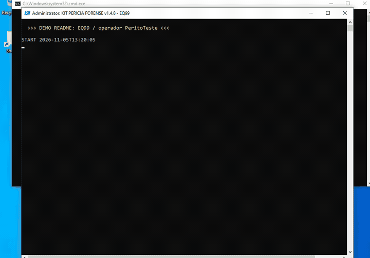

```
+------------------------------------------------------------------------------+
|  >_ KIT PERICIA FORENSE                                      [READ-ONLY]     |
|  __________________________________________________________________________  |
|   _  __ ___ _____   ____  _____ ____  ___ ____ ___    _                      |
|  | |/ /|_ _|_   _| |  _ \| ____|  _ \|_ _/ ___|_ _|  / \                     |
|  | ' /  | |  | |   | |_) |  _| | |_) || | |    | |  / _ \                    |
|  | . \  | |  | |   |  __/| |___|  _ < | | |___ | | / ___ \                   |
|  |_|\_\|___| |_|   |_|   |_____|_| \_\___\____|___/_/   \_\                  |
|  __________________________________________________________________________  |
|  | Coleta de inventario de software  |  PowerShell 5.1  |  v1.4.8          | |
|  | Somente leitura + rede/servidores |  Saida no pendrive |  EQ##          | |
|  |____[ SHA-256 manifesto ]__________|__[ sem telemetria ]|________________| |
+------------------------------------------------------------------------------+
```

# Kit Pericia Forense


**Coleta somente-leitura de inventario de software para vistoria / pericia judicial.**  
Roda no pendrive, grava so no pendrive, fecha com manifesto SHA-256. Sem telemetria, sem phone-home, sem nuvem.

> Autor: **Fabio Slika Stella** — CREA/PR PR-224755/D  
> Script atual: [`scripts/coleta_inventario_software_v1.4.8.ps1`](scripts/coleta_inventario_software_v1.4.8.ps1) · Lancador: [`scripts/rodar_coleta_v1.4.8.cmd`](scripts/rodar_coleta_v1.4.8.cmd)  
> Oficial anterior (v1.3): [`scripts/coleta_inventario_software_v1.3.ps1`](scripts/coleta_inventario_software_v1.3.ps1) · [`scripts/rodar_coleta_v1.3.cmd`](scripts/rodar_coleta_v1.3.cmd)

---

## Demo (VM de teste)

Execucao real do lancador na VM Windows 10 (EQ99 / operador de teste). Sem dados de caso.



---

## O que faz

Kit de campo para **inventario forense de software** em Windows. O perito leva o pendrive, executa o lancador como administrador, informa o `EQ##` e o nome do operador, e leva embora apenas o que foi gravado em `coleta\` no proprio pendrive.

A partir da **v1.4.8** o kit tambem:

- **Descobre servidores / compartilhamentos** que o PC acessa (SMB, UNC no registro, Recent `.lnk`, licenca `porta@host`, ARP/DNS/TCP, DC)
- **Deduplica** contra coletas anteriores no mesmo pendrive: se o servidor ja foi escaneado, **nao varre de novo** — so registra que este EQ tem acesso a ele
- **Inventaria formatos** de projeto/desenho (`.rvt`, `.dwg`, `.dxf`, `.ifc`, …): caminho, tamanho, datas de criacao/modificacao/acesso + resumo por extensao (contagem e min/max de datas). **Nao monta cronologia** — isso fica para o perito
- Mantem manifesto SHA-256 / `INDICE_COLETAS` mesmo se a coleta abortar; registra falhas de copia; copia `.lic` NLM; relogio/NTP; Prefetch com RunCount; hives de todos os perfis (com **fallback VSS** quando necessario)

---

## Garantias (read-only)

| Garantia | Como |
|----------|------|
| Nao instala / nao desinstala / nao repara MSI | Nao usa `Win32_Product`; le Uninstall via .NET somente leitura |
| Nao altera arquivos da maquina vistoriada | Leituras com share de leitura; timestamps da origem conferidos nas copias |
| Saida so no pendrive | Recusa gravar no disco do sistema (salvo `-ModoTeste` no PC do perito) |
| Hives | Deslogados: copia `NTUSER.DAT` + `reg load` so da copia; logado: FileShare/`reg save` **sem** `reg load`. Se a copia direta falhar, tenta **VSS (shadow copy)** e anota o metodo |
| Rede / servidores | Scan **somente leitura** com as credenciais da sessao; sem pedir senha; shares inacessiveis so sao documentados |
| Sem telemetria | Sem rede propria do kit, sem metrics, sem update check |
| Integridade | Todo arquivo gerado entra no manifesto SHA-256 (incluindo o `00_RESUMO.txt`) |

Inevitavel (efeito da diligencia, anotar na ata): o Windows registra a conexao do pendrive e a execucao do PowerShell (Prefetch, USBSTOR, logs). A opcao VSS cria shadow copy temporaria no PC — nao e 100% so-leitura; fica ligada porque o hive do perfil e evidencia critica.

---

## O que coleta

- Identificacao do host, discos, volumes, perfis, operador e ordem das etapas
- Relogio do sistema + referencia NTP/`w32tm` (inicio e fim)
- Programas (Uninstall 64/32 + `HKEY_USERS`)
- Prefetch (ultima execucao + contagem), Recent/Jump Lists, MRU
- Hosts, firewall (com hash SHA-256 dos binarios referenciados) e exclusoes do Defender
- Eventos MSI, limpeza de logs, servicos
- Arquivos de projeto e indicios de crack/keygen/ativador (+ copia automatica dos suspeitos)
- Authenticode + SHA-256 de binarios de licenciamento / indicios fortes
- Arquivos `.lic`/`.dat` referenciados (NLM/FLEXnet) alem do caminho no registro
- **Rede:** `servidores_descobertos.csv`, `acesso_pc_servidor.csv`, `servidores_escaneados.csv`, pastas `SRV_*`, `INDICE_SERVIDORES.txt`
- **Formatos:** `formatos_arquivos.csv`, `formatos_resumo.csv`
- Resumo `00_RESUMO.txt` + manifesto

Listas de fabricantes/indicios podem ir num `-Perfil` externo (`.psd1` / `.json`) para nao hardcodar o caso no script publicado.

---

## Versoes neste repositorio

So duas linhas de script ficam na arvore (intermediarias fora de uso foram removidas; o historico git preserva tudo):

| Versao | Papel |
|--------|-------|
| **v1.4.8** | **Atual** — use esta em campo. Rede/servidores com dedup + inventario de formatos; herda v1.4.7 (manifesto sempre, falhas de copia, `.lic`, NTP, Prefetch RunCount, hives+VSS, operador, menos FP) |
| **v1.3** | **Oficial estavel** anterior (pre-1.4) — `00_RESUMO` generico + `-Destacar`; plano B `coleta_minima_v1.2.cmd` |

Arquivos novos de versao **nunca sobrescrevem** os anteriores.

---

## Uso rapido (pendrive)

1. Copie para a raiz do pendrive:
   - `scripts/coleta_inventario_software_v1.4.8.ps1`
   - `scripts/rodar_coleta_v1.4.8.cmd`
   - `perfis/exemplo_generico.psd1` (opcional)
   - `KIT_SHA256.txt` + docs do pendrive (opcional)
2. No PC vistoriado: botao direito em `rodar_coleta_v1.4.8.cmd` → **Executar como administrador**.
3. Informe o ID (`EQ01` ou so `1`) e o nome do operador/perito.
4. Se aparecer arquivo **> 500 MB**, responda `S` ou `N`.
5. Fotografe o resumo + hash do manifesto; siga o checklist de capturas manuais.

### Opcoes do lancador (variaveis de ambiente)

| Variavel | Efeito |
|----------|--------|
| `set KIT_REDE=0` | Pula descoberta/scan de servidores (`-SemRede`) |
| `set KIT_HIVES=0` | Desliga carga de hives offline |
| `set KIT_COPIA_GRANDE=S` ou `N` | Responde automaticamente ao prompt >500 MB |
| `set KIT_OPERADOR=Nome` | Preenche o operador (o `.cmd` tambem pergunta) |

Codigos de saida: `0` ok · `2` destino recusado · `3`/`4` pasta · `5` perfil · `6` ID invalido.

Guia completo: [`docs/KIT_PENDRIVE_v1.4.8.md`](docs/KIT_PENDRIVE_v1.4.8.md) · Changelog: [`docs/CHANGELOG_v1.4.8.md`](docs/CHANGELOG_v1.4.8.md)

---

## Parametros principais (PowerShell)

| Parametro | Padrao | Efeito |
|-----------|--------|--------|
| `-Equip` | (obrigatorio) | `EQ##` — aceita `1` / `EQ1` / `EQ01` |
| `-Operador` | pergunta / `NAO_INFORMADO` | Nome do perito (log + INDICE) |
| `-Destino` | `.\coleta` | Pasta de saida (deve ficar no pendrive) |
| `-Perfil` | — | `.psd1` / `.json` com listas externas |
| `-SemRede` | off | Desliga rede/servidores |
| `-SegundosPorServidor` | `90` | Timeout por servidor |
| `-SegundosTotalServidores` | `300` | Timeout total de rede |
| `-ProfundidadeServidor` | `4` | Profundidade maxima no share |
| `-ExtensoesFormato` | lista CAD/BIM | Override das extensoes inventariadas |
| `-SemCabecalhoFormato` | off | Nao le assinatura DWG/PDF/OLE |
| `-CapturaTela` | off | PNG da tela no inicio (sessao interativa) |
| `-SemHivesOffline` | — | Desliga hives |
| `-SemCopiarSuspeitos` | — | Desliga copia automatica |
| `-RespostaCopiaGrande S\|N` | pergunta | Resposta automatica >500 MB |
| `-Destacar` | vazio | Destaca fabricantes no resumo (**nunca oculta** o resto) |
| `-ModoTeste` | off | Permite gravar fora do pendrive (so no PC do perito) |

---

## Saida tipica

```
D:\coleta\
|-- INDICE_COLETAS.txt
|-- INDICE_SERVIDORES.txt
\-- EQ01_HOSTNAME_yyyyMMdd_HHmmss\
    |-- 00_RESUMO.txt
    |-- 00_log_execucao.txt
    |-- 00_ordem_coleta.csv
    |-- 00_relogio_ntp.csv
    |-- servidores_descobertos.csv
    |-- acesso_pc_servidor.csv
    |-- servidores_escaneados.csv
    |-- formatos_arquivos.csv
    |-- formatos_resumo.csv
    |-- 11_indicios_*.csv / 11f_ / 11g_
    |-- suspeitos_copias\...
    |-- hives_offline\...
    |-- SRV_<id>\...          (so se o servidor ainda nao tinha sido escaneado)
    |-- MANIFESTO_SHA256.txt
    \-- MANIFESTO_SHA256.txt.sha256
```

Conferir o kit no pendrive:

```bash
sha256sum -c KIT_SHA256.txt --ignore-missing
```

Hashes: [`KIT_SHA256.txt`](KIT_SHA256.txt)

---

## Requisitos e limitacoes

- Windows 10/11, PowerShell 5.1, preferencialmente **Executar como administrador**
- Scan de rede usa so as credenciais de quem esta logado; sem prompt de senha
- O mesmo servidor pode aparecer duas vezes (nome e IP) se o ID estavel nao coincidir
- Varredura de formatos em disco local e limitada por tempo/profundidade (pode ficar parcial)
- Cabecalho Revit/Inventor completo nao e parseado (custo); DWG usa assinatura `AC10xx`
- Vizinhos so de ARP/DNS/TCP (`PULADO_SO_VIZINHO`) nao sao escaneados sem evidencia de share/UNC/licenca/DC
- Captura de tela exige console interativo (SSH puro falha no `CopyFromScreen`)

---

## Cenarios testados (laboratorio)

VM Windows 10 Enterprise Eval, PowerShell 5.1, QEMU TCG (sem KVM), pendrive simulado.

| Cenario | Versao | Resultado |
|---------|--------|-----------|
| Admin + rede (dedup 1a/2a coleta) | 1.4.8 | 1a varre `SRV_*`; 2a so documenta acesso |
| Admin, fixtures de crack | 1.4.7 | Manifesto confere; hive sessao ativa; 0 servicos FP |
| Usuario padrao (sem admin) | 1.4.7 | OK; hives desligados; manifesto confere |
| Lancador `eq01` (minusculas) | 1.4.5+ | Normaliza para `EQ01` |

---

## Changelog resumido

- **v1.4.8** *(atual)* — Rede/servidores com dedup; inventario de formatos (metadados); `KIT_REDE=0`; herda v1.4.7  
- **v1.4.7** — Manifesto/INDICE sempre; falhas de copia; `.lic` NLM; NTP; Prefetch RunCount; hives de todos os perfis (VSS); operador; menos FP  
- **v1.4.5** — Lancador `.cmd` sem PowerShell inline (`eq01` → `EQ01`)  
- **v1.3** *(oficial anterior)* — `00_RESUMO` generico + `-Destacar`

Detalhes: [`docs/CHANGELOG_v1.4.8.md`](docs/CHANGELOG_v1.4.8.md) · Pendrive: [`docs/KIT_PENDRIVE_v1.4.8.md`](docs/KIT_PENDRIVE_v1.4.8.md) · Oficial anterior: [`docs/KIT_PENDRIVE_v1.3.md`](docs/KIT_PENDRIVE_v1.3.md)

## Licenca e autor

[MIT](LICENSE) © 2026 Fabio Slika Stella (CREA/PR PR-224755/D).

Uso pericial / forense bem-vindo. **Nao publique dados de casos reais neste repositorio.** Sem telemetria.
