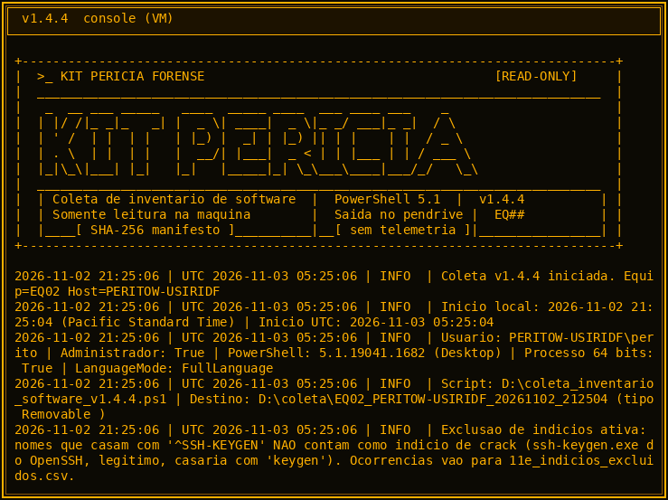
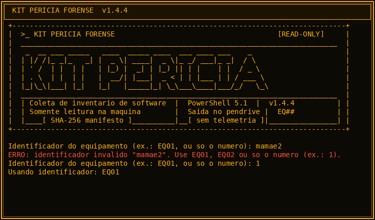
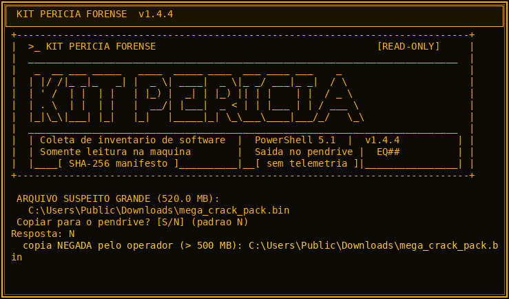
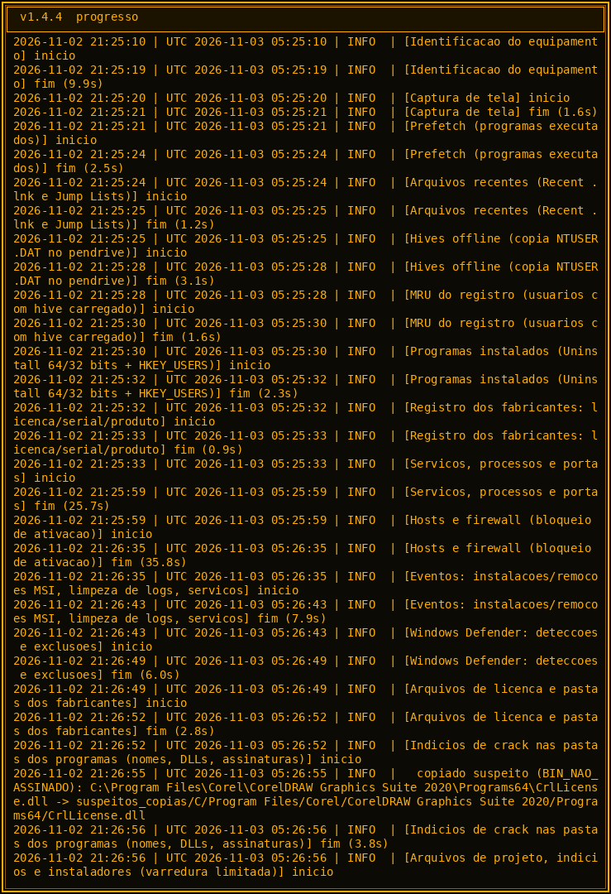
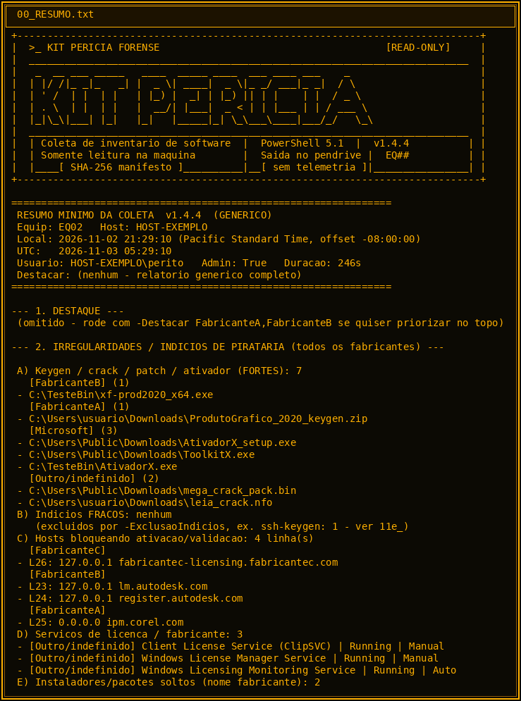
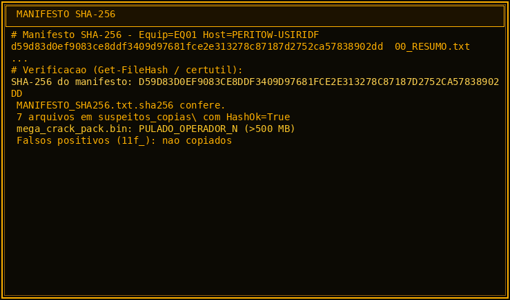
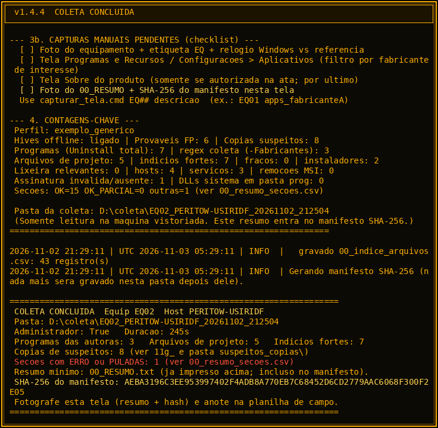

# Kit Pericia Forense

Coleta **somente leitura** de inventario de software em Windows (PowerShell 5.1), pensada para vistoria judicial / pericia. Saida no pendrive, manifesto SHA-256, sem telemetria.

```
+------------------------------------------------------------------------------+
|  >_ KIT PERICIA FORENSE                                      [READ-ONLY]     |
|  __________________________________________________________________________  |
|   _  __ ___ _____   ____  _____ ____  ___ ____ ___    _                      |
|  | |/ /|_ _|_   _| |  _ \| ____|  _ \|_ _/ ___|_ _|  / \                     |
|  | ' /  | |  | |   | |_) |  _| | |_) || | |    | |  / _ \                    |
|  | . \  | |  | |   |  __/| |___|  _ < | | |___ | | / ___ \                   |
|  |_|\_\|___| |_|   |_|   |_____|_| \_\___\____|___/_/   \_\                  |
|  __________________________________________________________________________  |
|  | Coleta de inventario de software  |  PowerShell 5.1  |  v1.4.4          | |
|  | Somente leitura na maquina        |  Saida no pendrive |  EQ##          | |
|  |____[ SHA-256 manifesto ]__________|__[ sem telemetria ]|________________| |
+------------------------------------------------------------------------------+
```



**Autor:** Fabio Slika Stella — CREA/PR PR-224755/D  
**Versao atual:** `v1.4.4` (`scripts/coleta_inventario_software_v1.4.4.ps1`)

---

## O que faz

1. Inventaria programas (Uninstall 64/32 + HKEY_USERS), Prefetch, hosts, firewall, Defender (com fallback via registro), eventos MSI, arquivos de projeto e **indicios de crack/keygen/ativador**.
2. Carrega hives de usuarios deslogados a partir de **copia** do `NTUSER.DAT` no pendrive (padrao ligado se admin).
3. Copia automaticamente suspeitos para `suspeitos_copias\` (SHA-256 origem/destino). Arquivos **> 500 MB** pedem confirmacao S/N.
4. Gera `00_RESUMO.txt` (com o banner) **antes** do `MANIFESTO_SHA256.txt`.

Nao instala, nao altera e nao apaga nada na maquina vistoriada. O Windows ainda registra a conexao do pendrive e a execucao do PowerShell (efeito da diligencia).

---

## Prints (VM de teste)

| Cena | Imagem |
|------|--------|
| Banner no inicio |  |
| Prompt ID EQ## (rejeita texto livre) |  |
| Prompt arquivo > 500 MB |  |
| Progresso das secoes |  |
| `00_RESUMO.txt` |  |
| Verificacao do manifesto |  |
| Tela final COLETA CONCLUIDA |  |

---

## Uso rapido (pendrive)

1. Copie o conteudo de `scripts/` + `perfis/exemplo_generico.psd1` + `KIT_SHA256.txt` para a raiz do pendrive.
2. No PC vistoriado: botao direito em `rodar_coleta_v1.4.4.cmd` → **Executar como administrador**.
3. Informe o ID (`EQ01` ou so `1`). Texto livre (ex.: `mamae2`) e rejeitado.
4. Fotografe o resumo + hash do manifesto; siga o checklist de capturas manuais.

Parametros uteis:

| Parametro | Efeito |
|-----------|--------|
| `-SemHivesOffline` | Desliga carga de hives deslogados |
| `-SemCopiarSuspeitos` | Desliga copia automatica |
| `-RespostaCopiaGrande S\|N` | Resposta automatica ao prompt >500 MB (teste) |
| `-Destacar FabricanteA,FabricanteB` | Destaca no topo do resumo (nunca oculta o resto) |
| `-Perfil caminho.psd1` | Listas externas (fabricantes/indicios) |
| `-ModoTeste` | Permite gravar fora do pendrive (so no PC do perito) |

---

## Uso em campo (referencia)

Pericia judicial de inventario de software (Brasil, out/2026), kit v1.2 em campo; laboratorio validou v1.4.x em VM Win10 PS 5.1:

- 9 PCs em campo (v1.2): media ~67 s/PC; 527 softwares; manifesto SHA-256 com 0 falhas.
- VM v1.4.4 (admin): ~250–300 s sob emulacao TCG; hives OK; copia de suspeitos com hash igual a origem; FP (`11f_`) nao copiados; `mega_crack` >500 MB respeita S/N.

---

## Fluxo

```
[pendrive] rodar_coleta_v1.4.4.cmd
    -> banner ASCII
    -> valida EQ##
    -> secoes (Prefetch, hives, Uninstall, hosts/firewall, Defender, varredura, assinaturas)
    -> copia suspeitos (11g_)
    -> unload hives (finally)
    -> 00_RESUMO.txt (com banner)
    -> MANIFESTO_SHA256.txt + .sha256
```

---

## Integridade

Hashes em [`KIT_SHA256.txt`](KIT_SHA256.txt). Versoes antigas sao preservadas lado a lado (nunca sobrescritas).

```bash
sha256sum -c KIT_SHA256.txt --ignore-missing
```

---

## Limitacoes / ainda a validar

- Captura de tela via SSH/sessao sem desktop interativo falha (usar console fisico ou `capturar_tela.cmd`).
- Relaunch 32→64 bits sob AppLocker restrito e PCs com AV corporativo agressivo: checklist de campo continua obrigatorio.
- Plano B `coleta_minima_v1.2.cmd` nao gera `00_RESUMO.txt`.

---

## Licenca

Uso pericial / forense. Sem telemetria. Nao publicar dados de casos reais neste repositorio.
